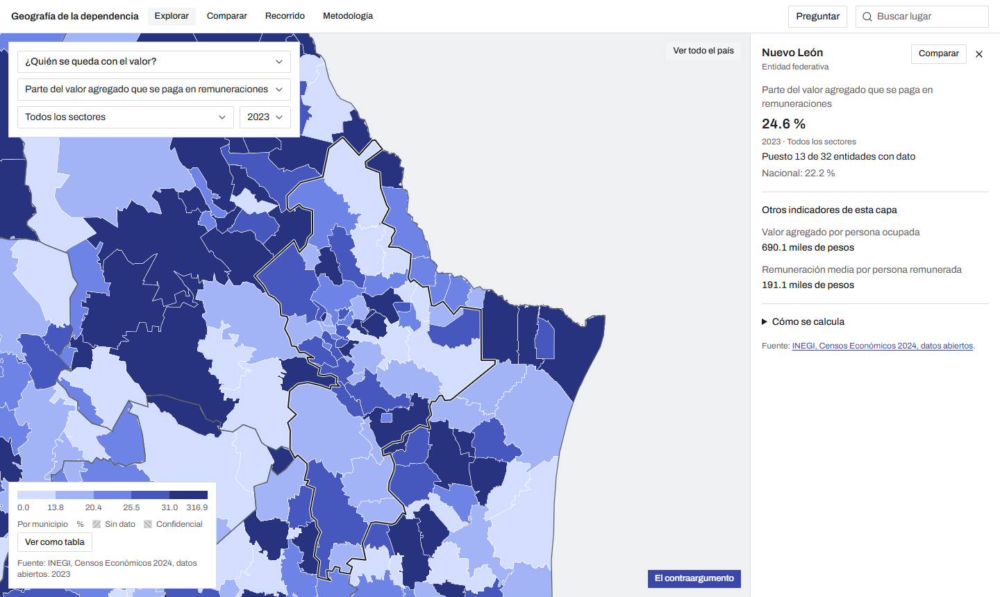

# Geografía de la dependencia

Mapa interactivo de México, a nivel estatal y municipal, que muestra con datos públicos cómo se distribuye en el territorio el peso del capital extranjero, quién se queda con el valor que se produce y si la integración exportadora mejora o no las condiciones de trabajo locales.

**Sitio:** [geografia-de-la-dependencia.vercel.app](https://geografia-de-la-dependencia.vercel.app)



## Qué se puede hacer

- **Explorar** cuatro capas, cada una con la pregunta que responde: el peso del capital extranjero, «¿derrama o enclave?» (mapa bivariado), quién se queda con el valor y quién da el empleo. Por entidad y, al acercarse, por municipio, con sector y año.
- **Ver la ficha** de cada territorio: valor, puesto, valor nacional, cómo se calcula y la fuente con enlace. Cada mapa tiene también una tabla accesible.
- **Comparar** hasta tres lugares en todos los indicadores.
- **El contraargumento**: un panel siempre a mano con los datos que pueden contradecir la tesis.
- **Recorrido** guiado en seis pasos. Su texto se edita en [`web/content/tour.json`](web/content/tour.json).
- **Metodología** generada a partir del catálogo de indicadores.
- **Preguntar a los datos**: un asistente que responde con las cifras del mapa usando modelos gratuitos de OpenRouter. Cada visitante usa su propia clave, que se guarda solo en su navegador; sin clave, el resto funciona igual.

Todo el estado vive en la URL, así que cualquier vista se comparte con un enlace.

## Principios

1. **Limpieza visual.** La pantalla muestra el mapa, una leyenda y una ficha.
2. **Limpieza del código.** Cualquiera debe poder leer el repositorio en una tarde y reproducir cada cifra.
3. **Honestidad con los datos.** Cada número lleva unidad, año y fuente. Lo que no existe se muestra como "sin dato", nunca como cero ni como estimación. La app enseña también la evidencia que contradice la tesis que acompaña.

## Estructura

| Directorio | Contenido |
|---|---|
| `pipeline/` | Python. Descarga las fuentes públicas, calcula los indicadores y genera los archivos que lee la web. |
| `web/` | Next.js. Sitio estático que lee esos archivos; no hay servidor ni base de datos. |
| `docs/` | Planteamiento del proyecto, fuentes y registro de decisiones. |

## Ejecutarlo en local

Requisitos: [uv](https://docs.astral.sh/uv/), [Node.js](https://nodejs.org/) 24 y [pnpm](https://pnpm.io/).

**Web**

```
cd web
pnpm install
pnpm dev
```

**Pipeline de datos**

```
cd pipeline
uv run pipeline build
```

La primera vez descarga unos 500 MB de archivos del INEGI y de la Secretaría de Economía a `pipeline/data/raw/` (fuera del repositorio) y tarda varios minutos. Cada archivo queda fijado por su suma de verificación en `pipeline/sources.lock.json`: si una fuente publica una versión nueva, el build se detiene en lugar de cambiar cifras en silencio. Para aceptar el cambio, ejecuta `uv run pipeline fetch --refresh` y revisa la diferencia.

El resultado se escribe en `web/public/data/` y se versiona. El flujo manual **Rebuild data** de GitHub Actions repite todo desde cero y falla si el resultado difiere de lo publicado.

## Comprobaciones

Las mismas que ejecuta la integración continua en cada push.

| | Pipeline (`pipeline/`) | Web (`web/`) |
|---|---|---|
| Formato y lint | `uv run ruff format --check` y `uv run ruff check` | `pnpm lint` |
| Tipos | `uv run pyright` | `pnpm typecheck` |
| Pruebas | `uv run python -m pytest` | `pnpm test` y `pnpm test:e2e` (necesita Chrome) |
| Evaluar el asistente | | `pnpm eval:bot` (necesita `OPENROUTER_API_KEY` en `.env`, ver `.env.example`) |
| Build | | `pnpm build` |

## Desplegar

El sitio se publica en [Vercel](https://vercel.com) como sitio estático, sin servidor ni variables de entorno:

1. En Vercel, crea un proyecto e importa este repositorio.
2. Como *Root Directory* elige `web`. Vercel detecta Next.js, pnpm y Node 24.
3. Tras el primer despliegue, activa *Web Analytics* en el proyecto y vuelve a desplegar: hasta entonces su script no existe y la consola lo avisa. Es la única analítica del sitio: sin cookies y servida desde el propio dominio.

Cada push a `main` vuelve a desplegar.

## Fuentes y licencias

El código se publica bajo licencia [MIT](LICENSE). Las fuentes de datos, sus términos de uso y sus limitaciones están en [docs/fuentes.md](docs/fuentes.md); el catálogo de indicadores, en [docs/spec.md](docs/spec.md). Los datos del INEGI se usan bajo sus [Términos de Libre Uso](https://www.inegi.org.mx/inegi/terminos.html), que exigen citar al INEGI como autor.

## Contribuir

Abre un issue antes de proponer un cambio grande. Los commits siguen [Conventional Commits](https://www.conventionalcommits.org/es/) y se escriben en inglés, igual que el código; la interfaz y la documentación van en español.
